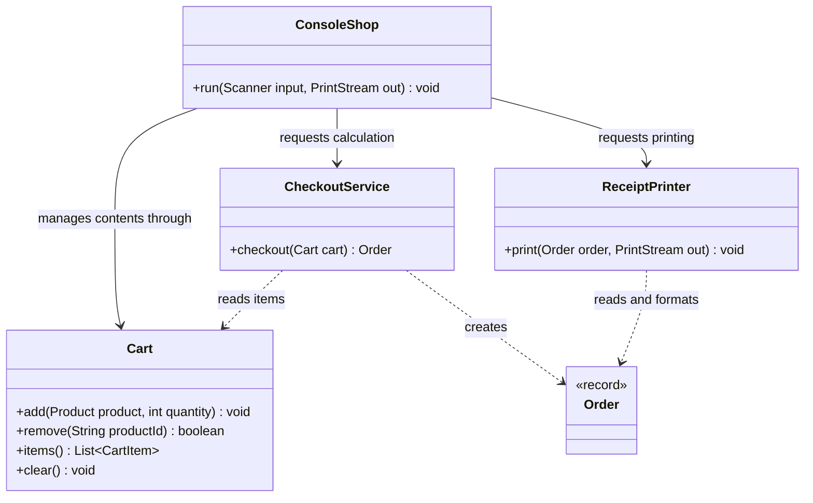
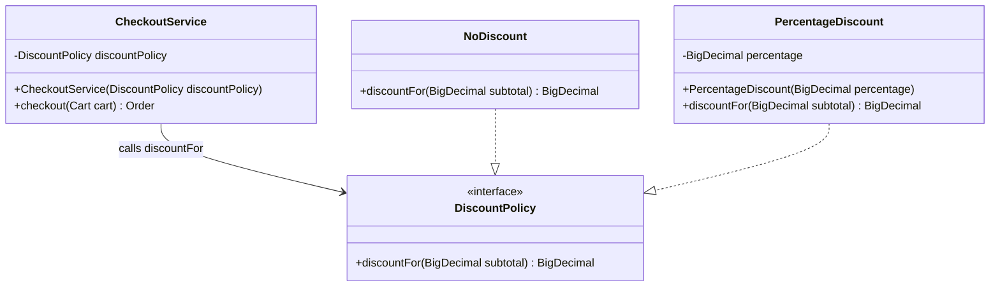
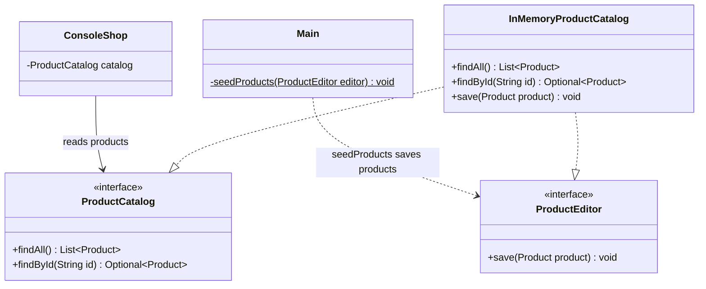

# Laboratory Report 1 — SOLID Principles

**Course:** Tehnici si mecanisme de proiectare software (TMPS)  
**Author:** Gafenco Victor  
**Group:** FAF-241  
**Topic:** Single Responsibility, Open/Closed, and Interface Segregation principles

## 1. Objective

Implement a simple Java ecommerce console application that demonstrates three
SOLID principles: **SRP**, **OCP**, and **ISP**. The application separates shopping
cart management, pricing, catalog access, and presentation so that each concept
can be identified in the source code and explained through its behavior.

## 2. Application overview

TMPS Shop lets the user browse products, add products to a cart, inspect the cart,
remove an item, and check out. Checkout applies a configured 10% discount, prints
a receipt, and clears the cart after the receipt is printed.

The implementation uses Java 17 or newer and Maven. Monetary values use
`BigDecimal` with two decimal places and `HALF_UP` rounding. Product and cart data
are stored in memory and are lost when the application exits. Checkout simulates
an order; real payments, stock management, and database persistence are outside
the scope of this laboratory.

## 3. Project structure

The repository root contains the parent Maven POM and Maven Wrapper. `lab1` is a
separate module containing the full application and its tests. Future laboratories
can be added as sibling modules without replacing this implementation.

```text
lab1/
├── README.md
├── pom.xml
└── src/
    ├── main/java/md/tmps/shop/
    │   ├── Main.java
    │   ├── ConsoleShop.java
    │   ├── Product.java
    │   ├── ProductCatalog.java
    │   ├── ProductEditor.java
    │   ├── InMemoryProductCatalog.java
    │   ├── Cart.java
    │   ├── CartItem.java
    │   ├── DiscountPolicy.java
    │   ├── NoDiscount.java
    │   ├── PercentageDiscount.java
    │   ├── CheckoutService.java
    │   ├── Order.java
    │   └── ReceiptPrinter.java
    └── test/java/md/tmps/shop/
        └── ShopTest.java
```

| File | Responsibility |
| --- | --- |
| [Main.java](src/main/java/md/tmps/shop/Main.java) | Application entry point; seeds products, selects the discount, and connects the objects. |
| [ConsoleShop.java](src/main/java/md/tmps/shop/ConsoleShop.java) | Displays the menu, reads input, and coordinates shopping operations. |
| [Product.java](src/main/java/md/tmps/shop/Product.java) | Immutable product record containing ID, name, and price, with validation. |
| [ProductCatalog.java](src/main/java/md/tmps/shop/ProductCatalog.java) | Read interface for listing and finding products. |
| [ProductEditor.java](src/main/java/md/tmps/shop/ProductEditor.java) | Write interface for saving products. |
| [InMemoryProductCatalog.java](src/main/java/md/tmps/shop/InMemoryProductCatalog.java) | Implements both catalog interfaces using a map indexed by product ID. |
| [Cart.java](src/main/java/md/tmps/shop/Cart.java) | Adds, merges, removes, lists, and clears cart items. |
| [CartItem.java](src/main/java/md/tmps/shop/CartItem.java) | Immutable product/quantity pair; validates quantity and calculates its subtotal. |
| [DiscountPolicy.java](src/main/java/md/tmps/shop/DiscountPolicy.java) | Contract for calculating a discount amount from an order subtotal. |
| [NoDiscount.java](src/main/java/md/tmps/shop/NoDiscount.java) | Discount policy that returns zero. |
| [PercentageDiscount.java](src/main/java/md/tmps/shop/PercentageDiscount.java) | Discount policy using a percentage between 0 and 100. |
| [CheckoutService.java](src/main/java/md/tmps/shop/CheckoutService.java) | Validates checkout, calculates totals, and creates an order snapshot. |
| [Order.java](src/main/java/md/tmps/shop/Order.java) | Immutable order record containing items, subtotal, discount, and total. |
| [ReceiptPrinter.java](src/main/java/md/tmps/shop/ReceiptPrinter.java) | Formats and prints an order receipt. |
| [ShopTest.java](src/test/java/md/tmps/shop/ShopTest.java) | JUnit tests for business rules and console behavior. |

### UML notation

The following Mermaid UML class diagrams represent selected classes, methods,
and relationships from the implementation. The visibility markers `+` and `-`
denote public and private members, respectively. A solid directed association
(`-->`) represents a stored reference, a dashed dependency (`..>`) represents
usage, and a realization relationship (`..|>`) represents interface
implementation. The hollow triangle points to the implemented interface.
Underlined operations denote static methods.

### Interface definitions

The application defines **three interfaces**: `DiscountPolicy`, `ProductCatalog`,
and `ProductEditor`. `NoDiscount` and `PercentageDiscount` implement the first;
`InMemoryProductCatalog` implements both of the others.

## 4. Single Responsibility Principle (SRP)

**Definition:** A class should have one reason to change. Responsibilities that
change for different reasons should be separated.

### UML: separate responsibilities



The diagram illustrates the separation of interaction coordination, cart
management, order calculation, and receipt presentation. `ConsoleShop` delegates
these operations to `Cart`, `CheckoutService`, and `ReceiptPrinter`, respectively.
Changes to receipt formatting are isolated in `ReceiptPrinter`, while changes to
quantity merging are isolated in `Cart`.

### Application of SRP

- **`Cart.add`, `remove`, `items`, and `clear`** manage cart contents. `add` merges
  repeated product IDs and checks integer overflow. Cart operations do not read
  console input or format receipts.
- **`CheckoutService.checkout`** takes a snapshot of cart items, rejects an empty
  cart, sums item subtotals, applies and validates a discount, and creates an
  `Order`. These operations belong to the responsibility of calculating an order.
- **`ReceiptPrinter.print`** receives an already-calculated `Order` and formats
  its contents and totals. Receipt layout is separate from pricing rules.
- **`ConsoleShop.run`** handles the menu, prompts, and user-facing errors, while
  delegating cart operations, calculations, and receipt formatting.
- **`InMemoryProductCatalog`** handles product storage and retrieval independently
  of the shopping workflow.

The checkout branch in `ConsoleShop.run` makes this separation visible:

```java
Order order = checkout.checkout(cart);
receipts.print(order, out);
cart.clear();
```

Each call delegates a distinct responsibility. For example, adding a line to the
receipt requires changing `ReceiptPrinter.print`; it does not require changing
`CheckoutService.checkout`. Changing how repeated cart additions are merged
belongs in `Cart.add`, independently of receipt presentation.

## 5. Open/Closed Principle (OCP)

**Definition:** Software should be open for extension and closed for modification.
An established component should support new behavior through an extension point
without requiring changes to its existing logic.

### UML: interchangeable discount policies



`CheckoutService` depends on the `DiscountPolicy` abstraction. `NoDiscount` and
`PercentageDiscount` provide concrete implementations of the same operation.
Additional discount policies can implement this contract without modifying the
checkout algorithm. Policy selection is performed in `Main`, and `discountFor`
returns the amount deducted from the subtotal.

### Application of OCP

The extension point is `DiscountPolicy.discountFor`:

```java
public interface DiscountPolicy {
    BigDecimal discountFor(BigDecimal subtotal);
}
```

`CheckoutService` receives this interface through its constructor and stores it
in the `discountPolicy` field. Inside `checkout`, the discount is obtained through:

```java
BigDecimal discount = discountPolicy.discountFor(subtotal);
```

Checkout does not check the concrete policy type. It validates the returned amount
and calculates the total using the same logic for every policy.

Two implementations are included:

- **`NoDiscount.discountFor`** returns `BigDecimal.ZERO`.
- **`PercentageDiscount.discountFor`** multiplies the subtotal by the configured
  percentage, divides by 100 using `movePointLeft(2)`, and rounds to two decimals.

`Main` keeps the configurable percentage in one named constant:

```java
private static final BigDecimal DISCOUNT_PERCENTAGE = new BigDecimal("10");
```

The configured percentage must be between 0 and 100. `Main.main` uses this
value for both the policy and the promotional message:

```java
DiscountPolicy discount = new PercentageDiscount(DISCOUNT_PERCENTAGE);
System.out.printf("Today's promotion: %s%% off every order.%n", DISCOUNT_PERCENTAGE);
```

This keeps startup configuration in `Main`, percentage calculations in
`PercentageDiscount`, and order calculations in `CheckoutService` (SRP).
Changing the percentage requires no changes to the checkout algorithm; new types
of discount still extend the `DiscountPolicy` interface (OCP). The segregated
catalog interfaces (ISP) remain independent of discount configuration.

### Example of extending the behavior

A fixed discount of up to 50 MDL can be supplied with the same interface:

```java
DiscountPolicy discount = subtotal -> subtotal.min(new BigDecimal("50.00"));
```

This alternative policy illustrates an extension to the configured promotion.
Its adoption requires updating the policy assignment and promotional message in
`Main.main`. The implementations of `CheckoutService`, `Cart`, and
`ReceiptPrinter` remain unchanged.

The policy must return a **discount amount**, rather than the final price.
`CheckoutService.checkout` rejects null, negative discounts, and discounts greater
than the subtotal. The test `newDiscountCanBeAddedWithoutChangingCheckout`
demonstrates that a new fixed-discount policy works with the existing service.

## 6. Interface Segregation Principle (ISP)

**Definition:** Clients should not be forced to depend on operations they do not
use. Interfaces should describe the capabilities needed by their consumers.

### UML: separate read and write contracts



`InMemoryProductCatalog` realizes two distinct interfaces over the same product
storage. `ConsoleShop` depends on the read operations defined by `ProductCatalog`,
whereas `Main.seedProducts` depends on the write operation defined by
`ProductEditor`. Each consumer therefore depends on the capabilities required by
its responsibility. The diagram presents these consumer contracts; object
construction and application configuration are performed separately in `Main.main`.

### Application of ISP

Product access is split into two interfaces:

```java
public interface ProductCatalog {
    List<Product> findAll();
    Optional<Product> findById(String id);
}

public interface ProductEditor {
    void save(Product product);
}
```

`InMemoryProductCatalog` implements both interfaces, allowing the same storage
object to serve different consumers through different contracts:

| Consumer | Declared dependency | Operations it needs |
| --- | --- | --- |
| `ConsoleShop` constructor and `catalog` field | `ProductCatalog` | `findAll` to display products and `findById` to select a product. |
| `Main.seedProducts(ProductEditor editor)` | `ProductEditor` | `save` to insert the initial products. |

The shopping console receives a read interface with no `save` method. Product
initialization receives a write interface without listing or lookup methods.
Although the storage implementation supports both capabilities, its consumers
do not need a combined interface with unrelated operations.

The test `readerSeesProductsAddedThroughEditor` writes through a `ProductEditor`
reference and reads through a `ProductCatalog` reference to verify that both
interfaces operate on the same underlying catalog.

## 7. Application flow

1. `Main.main` creates `InMemoryProductCatalog` and passes it to `seedProducts`
   through the `ProductEditor` interface.
2. `Main.main` creates the percentage discount, checkout service, receipt printer,
   and console application. The console receives the catalog as `ProductCatalog`.
3. `ConsoleShop.run` starts the menu loop. Adding a product looks it up in the
   catalog and passes it with the entered quantity to `Cart.add`.
4. On checkout, `CheckoutService.checkout` creates an order from the cart using
   the selected `DiscountPolicy`.
5. `ReceiptPrinter.print` displays the order. The console clears the cart and
   returns to the menu. Selecting `0` ends the application.

## 8. Build and usage

### Requirements

- A full **JDK 17 or newer**, including the Java compiler.
- Internet access for the first Maven Wrapper build to download Maven and dependencies.
- No separately installed Maven is required.

### From the repository root

On Linux or macOS:

```sh
./mvnw -pl lab1 -am package
java -jar lab1/target/lab1-1.0-SNAPSHOT.jar
```

On Windows PowerShell:

```powershell
.\mvnw.cmd -pl lab1 -am package
java -jar lab1/target/lab1-1.0-SNAPSHOT.jar
```

### From the lab1 directory

On Linux or macOS:

```sh
../mvnw package
java -jar target/lab1-1.0-SNAPSHOT.jar
```

On Windows PowerShell, use `..\mvnw.cmd package`, then the same `java -jar` command.

### In IntelliJ IDEA

1. Import the repository's root `pom.xml` as a Maven project.
2. Select a JDK 17 or newer as the project SDK and Maven runner JDK.
3. Select the Maven Wrapper in Maven settings and reload the Maven project.
4. Open `lab1/src/main/java/md/tmps/shop/Main.java` and run `Main.main`.

### Menu options

| Option | Action | Input and behavior |
| --- | --- | --- |
| `1` | Products | Displays product IDs, names, and prices. |
| `2` | Add to cart | Enter a product ID, then a positive whole-number quantity. Repeated additions increase the quantity. |
| `3` | View cart | Displays each product's ID, name, quantity, and line subtotal. |
| `4` | Remove item | Enter a product ID to remove its entire cart entry. |
| `5` | Checkout | Applies the discount, prints a receipt, and clears the cart. An empty cart is rejected. |
| `0` | Exit | Ends the application. |

Unknown product IDs, invalid quantities, and unsupported menu choices produce
messages so the user can continue interacting with the application.

### Example session

The initial catalog contains:

| ID | Product | Price |
| --- | --- | --- |
| `P1` | Mechanical keyboard | 850.00 MDL |
| `P2` | Wireless mouse | 350.00 MDL |
| `P3` | USB-C cable | 120.00 MDL |

Enter the following values, one per prompt:

```text
2
P1
2
5
0
```

This adds two keyboards, checks out, and exits. The receipt is:

```text
--- TMPS Shop receipt ---
Mechanical keyboard x2: 1700.00 MDL
Subtotal: 1700.00 MDL
Discount: 170.00 MDL
Total:    1530.00 MDL
Thank you for shopping!
```

The subtotal is `850.00 × 2 = 1700.00 MDL`; the 10% discount is `170.00 MDL`,
leaving a total of `1530.00 MDL`.

## 9. Testing

Run the module's tests from the repository root:

```sh
./mvnw -pl lab1 test
```

To build and verify every laboratory module:

```sh
./mvnw clean verify
```

[ShopTest.java](src/test/java/md/tmps/shop/ShopTest.java) contains nine tests:

| Test | What it verifies |
| --- | --- |
| `repeatedProductsMergeAndCanBeRemoved` | Repeated additions merge quantities, and an item can be removed. |
| `invalidQuantityDoesNotChangeCart` | Zero, negative, and overflowing quantity updates are rejected without changing the cart. |
| `percentageCheckoutCreatesIndependentOrderSnapshot` | Percentage totals are correct and clearing the cart does not change the order. |
| `newDiscountCanBeAddedWithoutChangingCheckout` | The checkout service accepts a new discount implementation as well as `NoDiscount`. |
| `monetaryRoundingUsesHalfUp` | Fractional-cent discounts are rounded consistently. |
| `checkoutRejectsEmptyCartAndInvalidDiscounts` | Empty carts, invalid discount amounts, and out-of-range percentages are rejected. |
| `readerSeesProductsAddedThroughEditor` | Segregated read/write interfaces share catalog data, and returned product lists cannot be modified. |
| `consoleRecoversFromBadInputChecksOutAndClearsCart` | The console recovers from invalid input, prints the expected total, and clears the cart. |
| `consoleHandlesEndOfInputDuringPrompt` | The console exits safely when input ends during a prompt. |

The implementation was verified with JDK 17: all nine tests passed. The packaged
JAR was also run through the two-keyboard checkout example shown above.
