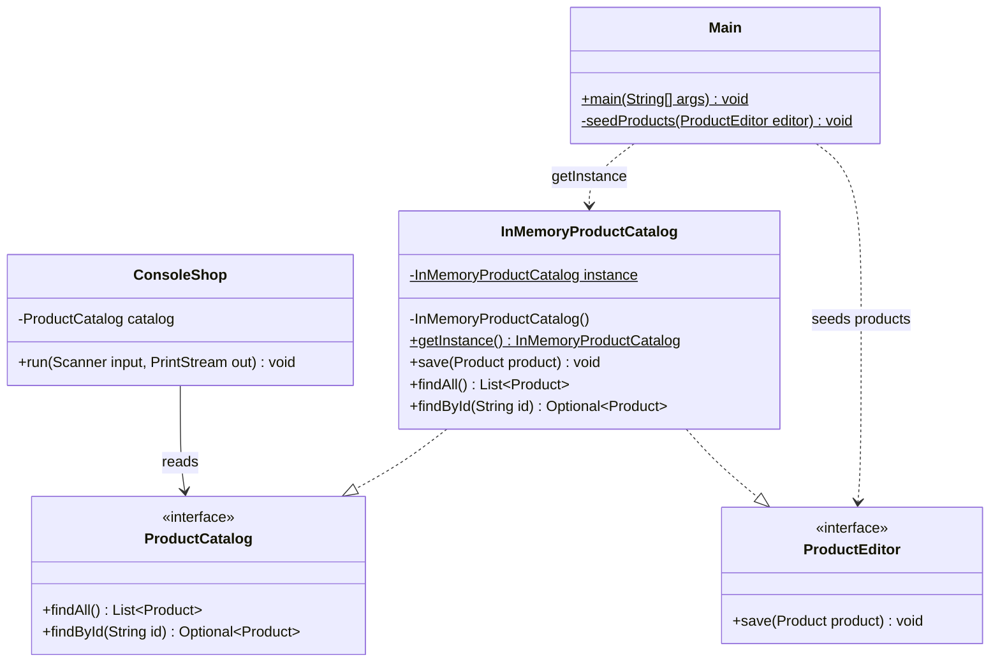
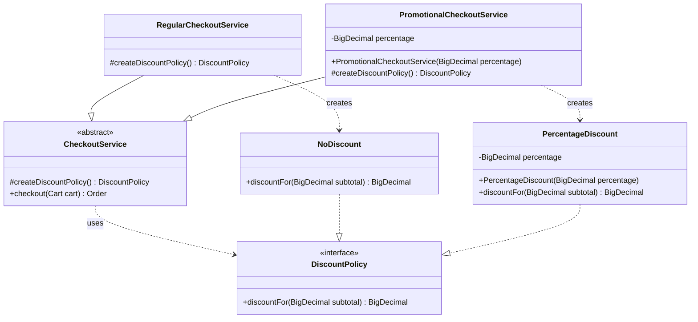
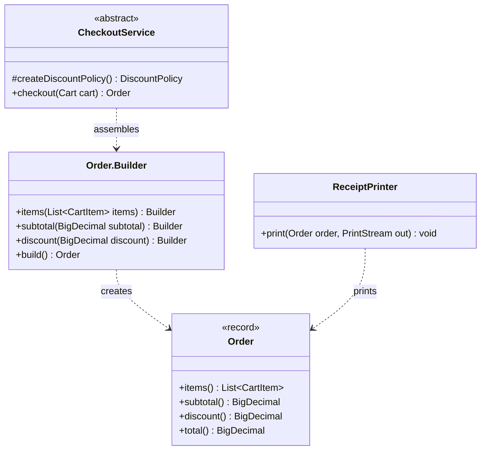

# Laboratory Report 2 — Creational Design Patterns

**Course:** Tehnici si mecanisme de proiectare software (TMPS)  
**Author:** Gafenco Victor  
**Group:** FAF-241  
**Topic:** Singleton, Factory Method, and Builder

## 1. Objective

Extend the Java ecommerce console application from laboratory 1 with three
creational design patterns: **Singleton**, **Factory Method**, and **Builder**.
Each pattern is used in the shopping flow: sharing the catalog, creating a
discount policy, and assembling an order.

## 2. Application overview

TMPS Shop lets the user browse products, add products to a cart, inspect the cart,
remove an item, and check out. By default, promotional checkout applies a 10%
discount. Starting the application with `--regular` selects checkout without a
discount. Both modes print a receipt and clear the cart after checkout.

The application uses Java 17 or newer and Maven. Monetary values use `BigDecimal`
with two decimal places and `HALF_UP` rounding. Products and cart contents are
stored in memory for the duration of the program.

## 3. Project structure

`lab2` is a separate Maven module following the package structure of `lab1`.

```text
lab2/
├── README.md
├── pom.xml
└── src/main/java/md/tmps/shop/
    ├── Main.java
    ├── ConsoleShop.java
    ├── Product.java
    ├── ProductCatalog.java
    ├── ProductEditor.java
    ├── InMemoryProductCatalog.java
    ├── Cart.java
    ├── CartItem.java
    ├── DiscountPolicy.java
    ├── NoDiscount.java
    ├── PercentageDiscount.java
    ├── CheckoutService.java
    ├── RegularCheckoutService.java
    ├── PromotionalCheckoutService.java
    ├── Order.java
    └── ReceiptPrinter.java
```

| File | Responsibility |
| --- | --- |
| [Main.java](src/main/java/md/tmps/shop/Main.java) | Gets the shared catalog, seeds products, selects the checkout mode, and starts the console. |
| [ConsoleShop.java](src/main/java/md/tmps/shop/ConsoleShop.java) | Handles the menu and delegates shopping operations. |
| [InMemoryProductCatalog.java](src/main/java/md/tmps/shop/InMemoryProductCatalog.java) | Singleton storing products by ID; implements the read and write catalog interfaces. |
| [ProductCatalog.java](src/main/java/md/tmps/shop/ProductCatalog.java), [ProductEditor.java](src/main/java/md/tmps/shop/ProductEditor.java) | Separate read and write contracts for the catalog. |
| [Product.java](src/main/java/md/tmps/shop/Product.java), [CartItem.java](src/main/java/md/tmps/shop/CartItem.java) | Immutable product and product/quantity records. |
| [Cart.java](src/main/java/md/tmps/shop/Cart.java) | Manages cart contents. |
| [DiscountPolicy.java](src/main/java/md/tmps/shop/DiscountPolicy.java) | Product interface for the Factory Method pattern. |
| [NoDiscount.java](src/main/java/md/tmps/shop/NoDiscount.java), [PercentageDiscount.java](src/main/java/md/tmps/shop/PercentageDiscount.java) | Concrete discount policies created by the checkout subclasses. |
| [CheckoutService.java](src/main/java/md/tmps/shop/CheckoutService.java) | Abstract creator defining the factory method and the shared checkout algorithm. |
| [RegularCheckoutService.java](src/main/java/md/tmps/shop/RegularCheckoutService.java) | Concrete creator returning `NoDiscount`. |
| [PromotionalCheckoutService.java](src/main/java/md/tmps/shop/PromotionalCheckoutService.java) | Concrete creator returning `PercentageDiscount`. |
| [Order.java](src/main/java/md/tmps/shop/Order.java) | Immutable order record with a nested `Builder`. |
| [ReceiptPrinter.java](src/main/java/md/tmps/shop/ReceiptPrinter.java) | Formats the completed order as a receipt. |

### UML notation

The diagrams show selected members. `+`, `-`, and `#` mean public, private, and
protected. `..>` means usage, `-->` means a stored reference, `..|>` means
interface implementation, and `--|>` means class inheritance. `$` marks a static
member. Hollow triangles point to the interface or parent class.

## 4. Singleton

**Definition:** Ensure that a class has one instance and provide a shared access
point to it.

### UML: shared product catalog



`Main` obtains the shared `InMemoryProductCatalog` and seeds it through
`ProductEditor.save`. `ConsoleShop` stores a `ProductCatalog` reference and uses
`findAll` and `findById` to browse and select products. The catalog implements both
interfaces over the same product storage, while its private constructor and
static access method control instance creation.

### Application of Singleton

`InMemoryProductCatalog` has a private constructor and a static instance field.
`getInstance()` creates the catalog on its first call and returns the same
instance on subsequent calls:

```java
public static InMemoryProductCatalog getInstance() {
    if (instance == null) {
        instance = new InMemoryProductCatalog();
    }
    return instance;
}
```

`Main` uses this access point in the running application:

```java
InMemoryProductCatalog catalog = InMemoryProductCatalog.getInstance();
seedProducts(catalog);
// The same catalog is passed to the shopping console.
ConsoleShop shop = new ConsoleShop(catalog, checkout, new ReceiptPrinter());
```

Setup saves products through `ProductEditor`; the console reads them through
`ProductCatalog`. Both interfaces refer to the same catalog object. A later call
to `getInstance()` also returns that populated catalog. The implementation uses
simple lazy initialization for this single-threaded console application.

## 5. Factory Method

**Definition:** Define a creation method in a parent class and let subclasses
choose which concrete product it returns.

### UML: checkout creates its discount policy



`CheckoutService` defines the shared checkout operation and the abstract creation
method. `RegularCheckoutService` creates `NoDiscount`, whose `discountFor` returns
zero. `PromotionalCheckoutService` stores the configured percentage and creates
`PercentageDiscount`, which validates that percentage is between 0 and 100 and
calculates the rounded discount amount. Both policies implement `DiscountPolicy`,
so checkout can use the same calculation contract for either product.

### Application of Factory Method

The creator is `CheckoutService`, and its factory method is:

```java
protected abstract DiscountPolicy createDiscountPolicy();
```

The shared `checkout` method reads cart items, calculates the subtotal, calls the
factory method, applies the returned policy, and builds the order:

```java
DiscountPolicy discountPolicy = createDiscountPolicy();
BigDecimal discount = discountPolicy.discountFor(subtotal);
```

The two concrete creators implement the creation step:

| Creator | Product returned | Behavior |
| --- | --- | --- |
| `RegularCheckoutService` | `new NoDiscount()` | No amount is deducted. |
| `PromotionalCheckoutService` | `new PercentageDiscount(percentage)` | The configured percentage is deducted. |

`Main` selects a creator using the optional `--regular` argument. `ConsoleShop`
then uses the common `CheckoutService` type. The checkout algorithm calls the
overridden factory method without checking which subclass was selected. This
demonstrates Factory Method through inheritance and an actual creation call in
the shared workflow.

## 6. Builder

**Definition:** Construct an object step by step and obtain the completed object
with a final build operation.

### UML: assembling an order



`CheckoutService` supplies the cart items and calculated amounts to
`Order.Builder`. The builder collects those values and creates an `Order` with
items, subtotal, discount, and total. `Order` is an immutable record that copies
the item list. `ReceiptPrinter` reads the completed record through its accessors
and prints the receipt without recalculating the order.

### Application of Builder

`Order.Builder` is a static nested class. Its setters return the builder so calls
can be chained. `CheckoutService.checkout` uses it after calculating and
validating the discount:

```java
return new Order.Builder()
        .items(items)
        .subtotal(subtotal)
        .discount(discount)
        .build();
```

Named methods make the monetary values easier to identify than several adjacent
`BigDecimal` constructor arguments. The builder defaults the discount to `0.00`,
so that step can be omitted for an order without a discount. `build()` derives
the total as `subtotal.subtract(discount)` and creates the order. The record
copies the item list, preserving the order after the console clears the cart.

The builder assembles values supplied by checkout; checkout remains responsible
for rejecting empty carts and invalid discount amounts.

## 7. Application flow

1. `Main` obtains the Singleton catalog and seeds three products.
2. `Main` selects promotional checkout by default or regular checkout when
   `--regular` is supplied, then passes the catalog and checkout to the console.
3. `ConsoleShop` reads products from the catalog and manages the cart.
4. On checkout, `CheckoutService` calculates the subtotal and calls its Factory
   Method to create the selected discount policy.
5. Checkout applies the policy and uses `Order.Builder` to assemble the order.
6. `ReceiptPrinter` prints the order, the console clears the cart, and the menu
   continues until the user selects `0`.
