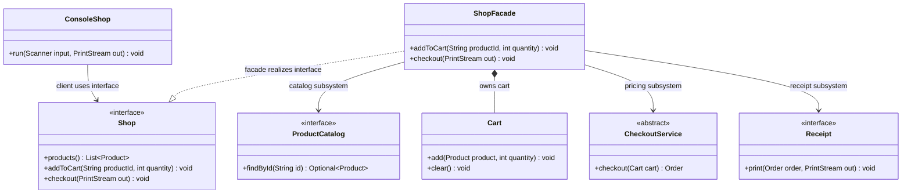
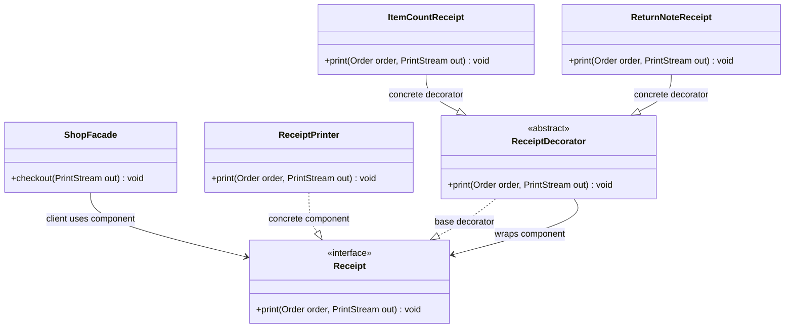
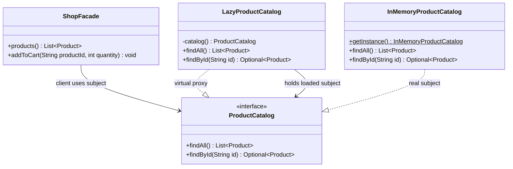

+# Laboratory Report 3 — Structural Design Patterns (Moodle Lab 2)

**Course:** Tehnici si mecanisme de proiectare software (TMPS)  
**Author:** Gafenco Victor  
**Group:** FAF-241  
**Topic:** Facade, Decorator, and Proxy

## 1. Objective

Extend the Java ecommerce console application from repository lab 2 with
three structural patterns. Use the patterns in the shopping workflow and verify
their key properties with JUnit.

## 2. Domain description

TMPS Shop lets customers browse a product catalog, add products to a cart,
change cart quantities, and check out. Promotional checkout deducts 10% by
default. Regular checkout charges the full subtotal. The application stores its
products and cart in memory and prints receipts in MDL.

The lab runs as a standalone Maven module. It carries over the previous lab's
Singleton catalog, Factory Method for selecting the discount policy, and
`Order.Builder` for creating the order consumed by the receipt component.
`Main` assembles the objects, `client` contains the console, and `domain` contains
`Product`, `CartItem`, `Cart`, and `Order`. The `facade`, `receipt`, `catalog`,
and `checkout` packages contain their respective subsystem code.

## 3. Pattern selection

| Pattern | Intent and fit in TMPS Shop |
| --- | --- |
| **Facade** | Give a client a small API for a subsystem. The console already coordinates the catalog, cart, checkout, and receipts, so moving that workflow behind a shop API is a small change. |
| **Decorator** | Add behavior by wrapping an object through its own interface. Independent receipt lines provide two visible additions that can be combined around the existing printer. |
| **Proxy** | Control access through a stand-in with the same interface. The existing catalog contract supports deferred loading and lets the proxy show exactly when initialization happens. |
| Adapter | Translate between incompatible interfaces. A supplier integration would fit once there is an actual external catalog or payment API to adapt. |
| Bridge | Let an abstraction and its implementation vary independently. Two independently varying dimensions, such as receipt formats and destinations, would require additional variants. |
| Composite | Expose individual objects and groups through one interface. Nested product bundles would fit and would introduce a new domain model. |
| Flyweight | Share immutable intrinsic state among many objects. The current catalog contains three products, and cart items already reference their product, so introducing flyweight storage would have little benefit. |

## 4. Facade

**Intent.** Provide one entry point for shopping operations that span multiple
subsystem objects. Checkout is the clearest example because it coordinates
calculation, printing, and clearing the cart.

### UML class diagram



### Implementation

[ShopFacade.java](src/main/java/md/tmps/shop/facade/ShopFacade.java)

```java
@Override
public boolean removeFromCart(String productId, int quantity) {
    return cart.remove(productId, quantity);
}

@Override
public void checkout(PrintStream out) {
    Order order = checkout.checkout(cart);
    receipt.print(order, out);
    cart.clear();
}
```

`ConsoleShop` calls `Shop.checkout`, and the facade passes the cart to
`CheckoutService` and the resulting order to `Receipt`. The facade owns the
sequence while the subsystem classes own pricing, receipt formatting, and
cart mutations.

### Unit tests

- `calculatesAndPrintsBeforeClearingTheCart` records the calculation and receipt
  calls in order, checks the total received by the receipt, and confirms the
  cart is empty after checkout.
- `leavesCartIntactWhenReceiptPrintingFails` supplies a receipt that throws and
  verifies that the error propagates and the cart contents remain available.

[ShopFacadeTest.java](src/test/java/md/tmps/shop/facade/ShopFacadeTest.java)

## 5. Decorator

**Intent.** Add optional receipt output at runtime. The item count and the
return reminder can be applied separately or stacked through the `Receipt`
interface.

### UML class diagram



### Implementation

[ItemCountReceipt.java](src/main/java/md/tmps/shop/receipt/ItemCountReceipt.java)

```java
public final class ItemCountReceipt extends ReceiptDecorator {
    public ItemCountReceipt(Receipt receipt) {
        super(receipt);
    }

    @Override
    public void print(Order order, PrintStream out) {
        super.print(order, out);
        long quantity = order.items().stream().mapToLong(CartItem::quantity).sum();
        out.printf("Items purchased: %d%n", quantity);
    }
}
```

`super.print` delegates to the wrapped `Receipt`, which can be the base
printer or another decorator. The item-count decorator then appends the sum of
the quantities, and the return-note decorator appends its reminder the same way.

### Unit tests

- `itemCountAddsTheTotalQuantityAndPreservesTheBaseReceipt` checks that two
  product lines with quantities two and three give an item count of five and
  preserve the original receipt text.
- `bothDecoratorsCanStackInEitherOrder` checks the complete output for each
  nesting order, including the unchanged base receipt and the order of the
  two additions.

[ReceiptDecoratorTest.java](src/test/java/md/tmps/shop/receipt/ReceiptDecoratorTest.java)

## 6. Proxy

**Intent.** Delay catalog creation and seeding until the first product request.
A session that exits at the first menu, for example, never loads the catalog.

### UML class diagram



### Implementation

[LazyProductCatalog.java](src/main/java/md/tmps/shop/catalog/LazyProductCatalog.java)

```java
@Override
public List<Product> findAll() {
    return catalog().findAll();
}

@Override
public Optional<Product> findById(String id) {
    return catalog().findById(id);
}

private synchronized ProductCatalog catalog() {
    if (catalog == null) {
        catalog = Objects.requireNonNull(loader.get(), "loaded catalog");
    }
    return catalog;
}
```

Both operations forward through the catalog accessor, which calls the supplier
on first use and stores the loaded subject. The proxy shares the real catalog's
interface and preserves its lookup and listing results.

### Unit tests

- `loadsOnFirstLookupAndReusesTheCatalog` counts loader calls. It expects zero
  at construction, one after the first lookup, and one after subsequent
  list and lookup calls.
- `forwardsListingAndLookupResults` checks that the listing matches the
  subject, a known ID returns the same product object, and a missing ID
  returns an empty result.

[LazyProductCatalogTest.java](src/test/java/md/tmps/shop/catalog/LazyProductCatalogTest.java)

## 7. How the patterns interact

1. The console handles **Add to cart** through the `Shop` interface.
   `ShopFacade` looks up the ID through `ProductCatalog`, where
   `LazyProductCatalog` loads the catalog if necessary and forwards the lookup.
2. The console handles **Checkout** through the same `Shop` interface.
   `ShopFacade` passes the cart to `CheckoutService`, whose Factory Method
   supplies the discount policy and whose Builder produces the order.
3. The facade calls `Receipt.print`. In the default composition the call
   enters `ReturnNoteReceipt`, delegates to `ItemCountReceipt`, and then reaches
   `ReceiptPrinter`. As the calls return, each decorator appends its line. The
   facade clears the cart once the receipt call completes.

Adding a product uses Facade and Proxy on the same execution path. Checking out
uses Facade and Decorator on another path in the same shopping session.

A new receipt line can be added in a class extending `ReceiptDecorator`. A new
composition can wrap the existing chain with that class via the `Receipt`
constructor parameter of `ShopFacade`. A different catalog implementation can
likewise be supplied to the proxy through its loader.

## 8. Verification

Run the tests and build the executable JAR from the repository root:

```sh
./mvnw -pl lab3 -am clean verify
```

Maven Surefire output from the full reactor's `clean verify` run:

```text
[INFO] Running md.tmps.shop.catalog.LazyProductCatalogTest
[INFO] Tests run: 2, Failures: 0, Errors: 0, Skipped: 0, Time elapsed: 0.094 s -- in md.tmps.shop.catalog.LazyProductCatalogTest
[INFO] Running md.tmps.shop.facade.ShopFacadeTest
[INFO] Tests run: 2, Failures: 0, Errors: 0, Skipped: 0, Time elapsed: 0.022 s -- in md.tmps.shop.facade.ShopFacadeTest
[INFO] Running md.tmps.shop.receipt.ReceiptDecoratorTest
[INFO] Tests run: 2, Failures: 0, Errors: 0, Skipped: 0, Time elapsed: 0.025 s -- in md.tmps.shop.receipt.ReceiptDecoratorTest
[INFO] Tests run: 6, Failures: 0, Errors: 0, Skipped: 0
[INFO] BUILD SUCCESS
```

## 9. Conclusions

The main design issue was choosing where checkout ends. The facade needs to
coordinate calculation, printing, and cart clearing in that order so a thrown
receipt error leaves the cart available. Reusing the order builder kept subtotal
and discount calculations inside checkout, where both receipt variants can
consume the same completed order.

If the shop added file or network receipts, I would give receipt delivery an
explicit failure contract so the facade could distinguish an order calculation
failure from an output failure and handle retries accordingly.
