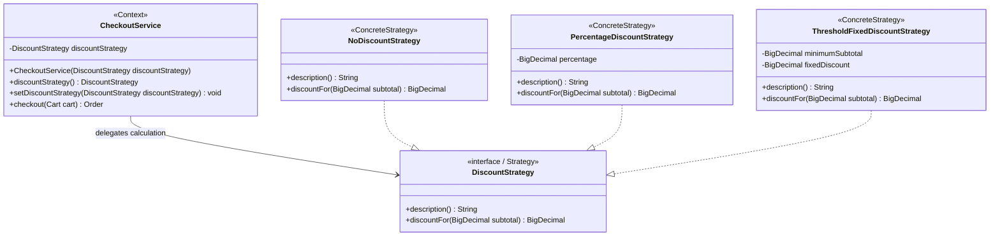
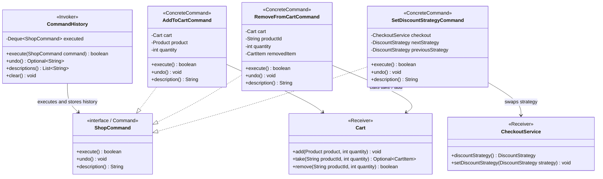
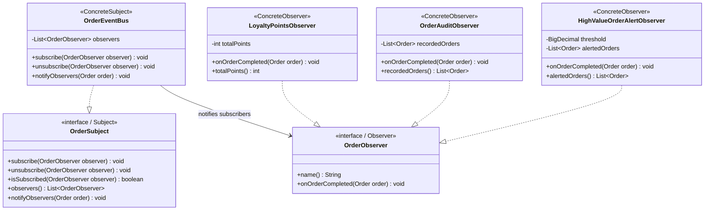

# Laboratory Report 4 — Behavioral Design Patterns (Moodle Lab 3)

**Course:** Tehnici si mecanisme de proiectare software (TMPS)  
**Author:** Gafenco Victor  
**Group:** FAF-241  
**Topic:** Strategy, Command, and Observer

## 1. Objective

Extend the Java ecommerce console application from repository lab 3 (Moodle Lab 2)
with three behavioral design patterns that cooperate in the shopping workflow,
allow runtime behavior changes driven by user input, and are verified with
automated JUnit tests.

## 2. Domain description

TMPS Shop is an in-memory console store priced in MDL. Customers browse a
lazily loaded product catalog, add and remove cart items with undo support,
switch the active discount rule at runtime, subscribe or unsubscribe post-order
notification listeners, and check out with a decorated receipt.

The module builds directly on the previous lab's architecture. It preserves the
Singleton catalog (`InMemoryProductCatalog`), Virtual Proxy (`LazyProductCatalog`),
Order Builder (`Order.Builder`), Facade (`Shop` / `ShopFacade`), and Receipt
Decorators (`ItemCountReceipt`, `ReturnNoteReceipt`). The previous lab's
compile-time Factory Method subclasses (`RegularCheckoutService`,
`PromotionalCheckoutService`) are refactored into a runtime-swappable Strategy
context (`CheckoutService`), while cart/discount actions are routed through a
Command history and completed orders are broadcast to Observers.

## 3. Pattern selection and justification

| Pattern | Fit in TMPS Shop |
| --- | --- |
| **Strategy** (selected) | Solves the rigid compile-time checkout discount from Lab 3. Refactoring `CheckoutService` to delegate to a swappable `DiscountStrategy` lets users switch pricing rules at runtime without `if/else` branching inside checkout. |
| **Command** (selected) | Solves accidental cart and discount edits by encapsulating `AddToCartCommand`, `RemoveFromCartCommand`, and `SetDiscountStrategyCommand` behind `ShopCommand`, enabling an undo stack in `CommandHistory` while keeping business logic in the receivers (`Cart`, `CheckoutService`). |
| **Observer** (selected) | Solves post-checkout side effects (loyalty points, audit logging, high-value alerts) without coupling `ShopFacade` to concrete listeners, while allowing runtime subscription and unsubscription via `OrderEventBus`. |
| Chain of Responsibility | Useful when a request must be tried by multiple independent handlers (e.g., validation or support escalation). Checkout already validates inputs directly, so a chain would add indirection without a clear domain need. |
| Iterator | Java's `List` and `Collection` already iterate over products and cart items cleanly; wrapping them with a custom iterator would not provide a distinct traversal algorithm. |
| Mediator | `ShopFacade` already coordinates the few subsystems behind a simplified API without circular colleague dependencies. |
| Memento | Could snapshot the entire `Cart` for undo, but Command naturally captures both cart edits and discount strategy switches in one uniform undo history without cloning collections on every edit. |
| State | Would fit an order fulfillment workflow (`Pending -> Paid -> Shipped -> Delivered`), which would introduce post-checkout lifecycle concepts outside the current store scope. |
| Template Method | Checkout shares a single fixed sequence with only one varying step (discount calculation), which favors composition via Strategy over inheritance. |
| Visitor | Fits stable object hierarchies needing many unrelated operations; our domain has a flat product model and no polymorphic element tree. |

## 4. Strategy

**Intent.** Define a family of interchangeable discount algorithms behind one
interface (`DiscountStrategy`) and allow `CheckoutService` to switch between
them at runtime without conditional branching.

### UML class diagram



### Code snippet

[CheckoutService.java](src/main/java/md/tmps/shop/strategy/CheckoutService.java)

```java
public final class CheckoutService {
    private DiscountStrategy discountStrategy;

    public CheckoutService(DiscountStrategy discountStrategy) {
        this.discountStrategy = Objects.requireNonNull(discountStrategy, "discountStrategy");
    }

    public DiscountStrategy discountStrategy() {
        return discountStrategy;
    }

    public void setDiscountStrategy(DiscountStrategy discountStrategy) {
        this.discountStrategy = Objects.requireNonNull(discountStrategy, "discountStrategy");
    }

    public Order checkout(Cart cart) {
        List<CartItem> items = cart.items();
        if (items.isEmpty()) {
            throw new IllegalArgumentException("Your cart is empty.");
        }
        BigDecimal subtotal = items.stream()
                .map(CartItem::subtotal)
                .reduce(new BigDecimal("0.00"), BigDecimal::add);
        BigDecimal discount = discountStrategy.discountFor(subtotal);
        if (discount == null || discount.signum() < 0 || discount.compareTo(subtotal) > 0) {
            throw new IllegalArgumentException("Discount must be between zero and the subtotal.");
        }
        discount = discount.setScale(2, RoundingMode.HALF_UP);
        return new Order.Builder()
                .items(items).subtotal(subtotal).discount(discount).build();
    }
}
```

`CheckoutService` holds a `DiscountStrategy` reference that can be replaced at
runtime via `setDiscountStrategy` and calls `discountStrategy.discountFor(subtotal)`
with no `if/else` or `instanceof` checks. Adding a new discount algorithm only
requires creating a new class that implements `DiscountStrategy`.

### Unit tests

- `eachStrategyProducesExpectedDiscount` checks `NoDiscountStrategy`,
  `PercentageDiscountStrategy` (10% off), and `ThresholdFixedDiscountStrategy`
  both below and at/above the 500.00 MDL minimum subtotal.
- `checkoutSwapsStrategiesAtRuntimeAndSupportsNewImplementations` reuses a
  single `CheckoutService` across all three built-in strategies plus a custom
  flat-discount strategy added without modifying `CheckoutService`, verifying
  every resulting `Order` total.

[DiscountStrategyTest.java](src/test/java/md/tmps/shop/strategy/DiscountStrategyTest.java)

## 5. Command

**Intent.** Encapsulate shopping actions (adding/removing cart items and
switching discount strategies) as `ShopCommand` objects so `CommandHistory` can
execute them uniformly and undo them in reverse order.

### UML class diagram



### Code snippet

[RemoveFromCartCommand.java](src/main/java/md/tmps/shop/command/RemoveFromCartCommand.java)

```java
    @Override
    public boolean execute() {
        removedItem = cart.take(productId, quantity).orElse(null);
        return removedItem != null;
    }

    @Override
    public void undo() {
        if (removedItem != null) {
            cart.add(removedItem.product(), removedItem.quantity());
        }
    }
```

`RemoveFromCartCommand` delegates quantity removal to the receiver (`Cart.take`)
and records the exact `CartItem` that was actually removed, so `undo()` restores
the exact previous quantity even when the user requested removing more units
than were in the cart. Returning `false` when the item is absent tells
`CommandHistory` not to push a no-op entry onto the undo stack.

### Unit tests

- `addAndRemoveCommandsRestoreOriginalCartStateOnUndo` executes additions and
  an over-quantity removal (removing 5 when only 2 exist), verifies a missing
  item is not recorded, and undoes all commands in LIFO order to prove the
  exact prior cart states are restored.
- `setDiscountStrategyCommandRestoresPreviousStrategyOnUndo` changes the active
  strategy through `CommandHistory`, verifies `CheckoutService` switched to the
  new strategy, undoes the command, and confirms the previous strategy is
  restored safely.

[CommandHistoryTest.java](src/test/java/md/tmps/shop/command/CommandHistoryTest.java)

## 6. Observer

**Intent.** Decouple order completion from independent post-checkout reactions
so multiple observers can subscribe, react automatically, and unsubscribe at
runtime without modifying the checkout or facade classes.

### UML class diagram



### Code snippet

[OrderEventBus.java](src/main/java/md/tmps/shop/observer/OrderEventBus.java)

```java
    @Override
    public void subscribe(OrderObserver observer) {
        Objects.requireNonNull(observer, "observer");
        if (!observers.contains(observer)) {
            observers.add(observer);
        }
    }

    @Override
    public void unsubscribe(OrderObserver observer) {
        observers.remove(observer);
    }

    @Override
    public void notifyObservers(Order order) {
        Objects.requireNonNull(order, "order");
        for (OrderObserver observer : List.copyOf(observers)) {
            observer.onOrderCompleted(order);
        }
    }
```

`OrderEventBus` depends exclusively on the `OrderObserver` interface and
iterates over an immutable snapshot (`List.copyOf(observers)`) during
notification so dynamic subscribe/unsubscribe operations cannot cause
concurrent modification issues. Because observers only read the immutable
`Order` record, notifications cannot trigger feedback loops.

### Unit tests

- `allSubscribedObserversAreNotifiedOnOrderCompletion` subscribes
  `LoyaltyPointsObserver`, `OrderAuditObserver`, and
  `HighValueOrderAlertObserver`, publishes an 850.00 MDL order, and asserts
  that all three updated their state and produced their expected console lines.
- `unsubscribedObserverStopsReceivingNotifications` notifies two subscribers,
  unsubscribes `LoyaltyPointsObserver`, notifies again, and verifies that the
  remaining observer received both orders while the unsubscribed observer kept
  only the points from the first order.

[OrderObserverTest.java](src/test/java/md/tmps/shop/observer/OrderObserverTest.java)

## 7. How the patterns interact

A single checkout flow passes through all three behavioral patterns alongside
the preserved creational and structural patterns:

1. `ConsoleShop` depends only on the `Shop`, `DiscountStrategy`, and
   `OrderObserver` abstractions (zero concrete pattern imports).
2. Adding products calls `ShopFacade.addToCart`, which loads the product via
   the **Proxy** (`LazyProductCatalog`) and executes `AddToCartCommand`
   (**Command**) through `CommandHistory`.
3. Switching discounts calls `ShopFacade.setDiscountStrategy`, which executes
   `SetDiscountStrategyCommand` (**Command**) to swap the active
   `DiscountStrategy` (**Strategy**) inside `CheckoutService`. Choosing
   **Undo** reverts either cart edits or discount changes via `CommandHistory`.
4. Checking out calls `ShopFacade.checkout` (**Facade**), which runs
   `CheckoutService.checkout` using the active **Strategy** and `Order.Builder`
   (**Builder**), prints the receipt through the **Decorator** chain
   (`ReturnNoteReceipt` -> `ItemCountReceipt` -> `ReceiptPrinter`), clears the
   cart and command history, and calls `OrderSubject.notifyObservers(order)`
   (**Observer**) to trigger all currently subscribed listeners.

This cooperation is verified directly in
`ShopFacadeTest.commandStrategyAndObserverCooperateAcrossCheckoutFlow`.

## 8. Verification

Run the tests and build the executable JAR from the repository root:

```sh
./mvnw -pl lab4 -am clean verify
```

Maven Surefire output from the `clean verify` run (13 tests total, 0 failures):

```text
[INFO] -------------------------------------------------------
[INFO]  T E S T S
[INFO] -------------------------------------------------------
[INFO] Running md.tmps.shop.catalog.LazyProductCatalogTest
[INFO] Tests run: 2, Failures: 0, Errors: 0, Skipped: 0, Time elapsed: 0.059 s -- in md.tmps.shop.catalog.LazyProductCatalogTest
[INFO] Running md.tmps.shop.command.CommandHistoryTest
[INFO] Tests run: 2, Failures: 0, Errors: 0, Skipped: 0, Time elapsed: 0.015 s -- in md.tmps.shop.command.CommandHistoryTest
[INFO] Running md.tmps.shop.facade.ShopFacadeTest
[INFO] Tests run: 3, Failures: 0, Errors: 0, Skipped: 0, Time elapsed: 0.023 s -- in md.tmps.shop.facade.ShopFacadeTest
[INFO] Running md.tmps.shop.observer.OrderObserverTest
[INFO] Tests run: 2, Failures: 0, Errors: 0, Skipped: 0, Time elapsed: 0.004 s -- in md.tmps.shop.observer.OrderObserverTest
[INFO] Running md.tmps.shop.receipt.ReceiptDecoratorTest
[INFO] Tests run: 2, Failures: 0, Errors: 0, Skipped: 0, Time elapsed: 0.008 s -- in md.tmps.shop.receipt.ReceiptDecoratorTest
[INFO] Running md.tmps.shop.strategy.DiscountStrategyTest
[INFO] Tests run: 2, Failures: 0, Errors: 0, Skipped: 0, Time elapsed: 0.004 s -- in md.tmps.shop.strategy.DiscountStrategyTest
[INFO]
[INFO] Results:
[INFO]
[INFO] Tests run: 13, Failures: 0, Errors: 0, Skipped: 0
[INFO] BUILD SUCCESS
```

## 9. Conclusions

The trickiest part of the refactoring was making `RemoveFromCartCommand` restore
exact cart state on undo without duplicating cart quantity logic inside the
command. Adding `Cart.take`, which returns the exact `CartItem` actually
removed, kept all business rules in the receiver while handling partial and
over-quantity removals cleanly. A second subtle design decision was ordering
checkout steps so that a failing receipt printer prevents both cart clearing
and observer notifications.

If this application grew further, I would add a redo stack to `CommandHistory`
and introduce typed domain events (for example, `OrderCompletedEvent` carrying
an order ID and timestamp) instead of passing `Order` directly to observers, so
additional event kinds could share the same event bus without changing the
`Order` record.
